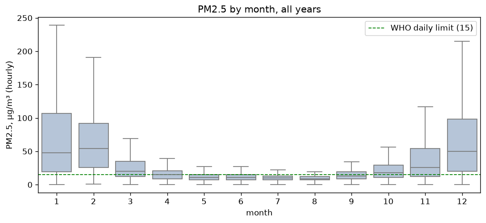
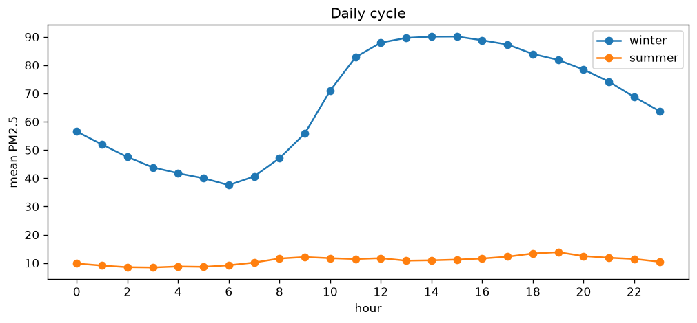

Almaty Smog

A project about air pollution in Almaty. Still in progress.

I live in Almaty, and the air gets really bad here in winter. I wanted to look at the data and understand why this happens and whether it gets better over time.

The city sits at the foot of the mountains. In winter, cold air can stay trapped near the ground. This is called a temperature inversion, and it makes it harder for pollution to escape. Coal heating also adds to the pollution.

CHP-2 is expected to switch from coal to gas by the end of 2026. I want to see whether this makes a difference to the air.

What I'm trying to find out

- Can a simple model using local data predict tomorrow's PM2.5 better than the CAMS forecast?
- What matters most for smog: heating, traffic, or weather?
- After CHP-2 switches to gas, does pollution go down because of the switch, or because the winter is warmer?

Data I use

- PM2.5: OpenAQ, from the US Embassy station in Almaty. The original data comes from AirNow.
- Weather: hourly historical data from Open-Meteo.
- Forecast: CAMS PM2.5 predictions from the Open-Meteo air quality API.
- before march 2024 Almaty was on UTC+6 then it switched to UTC+5 Open Meteo uses UTC+5 for all years but the embassy data used the old time so pollution and weather were one hour out of sync now everything uses UTC+5
- BLH is the height of the air layer where pollution mixes the lower it is the more pollution stays near the ground Open Meteo has no BLH data for january through june 2024

How to run it

Create a virtual environment and install the dependencies:

```powershell
py -3.13 -m venv .venv
.venv\Scripts\activate
pip install -r requirements.txt
```

Get a free API key from OpenAQ. Copy `.env.example` to `.env` and add your key.

Then download the data:

```powershell
python src/download_weather.py
python src/download_cams.py
python src/download_openaq.py
```


Winter is about 6 times dirtier than summer the worts moths are december, january and february. Then air gets better in march and turns bad again in November when heating starts

Firtsly, I thought that the worst air would be in the evenings, but in winter the is around 12:00-16:00. The cleanest time is early morning, around 6:00. In the summer the air is clean all day and  the line almost flat
I don't what are the reasons for this
